<div align="center">


# Moody

**A modern minimalist mood journal**

Check in every day, see your emotional trends and export reports. Light & dark themes, English / Tiếng Việt, installable as a PWA.

**English** · [Tiếng Việt](README.vi.md)


<br />

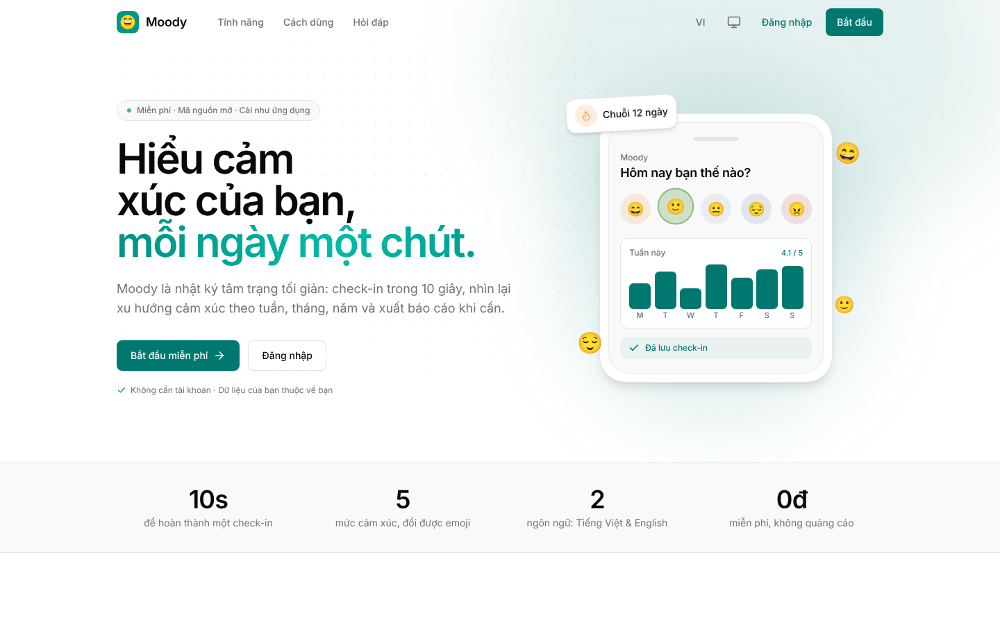
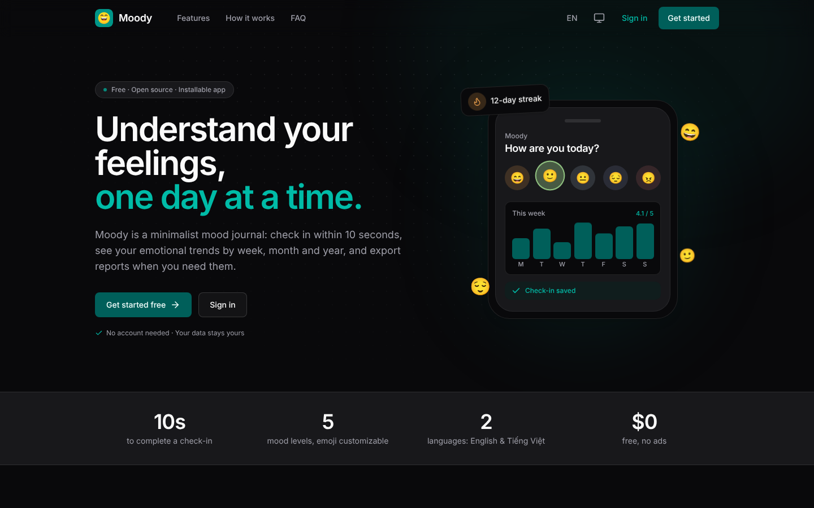

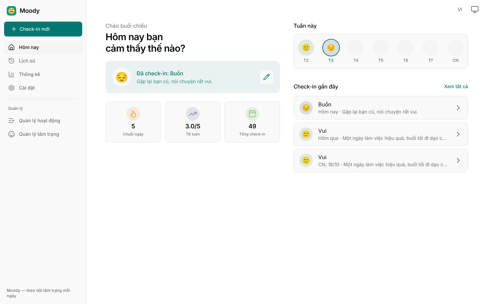
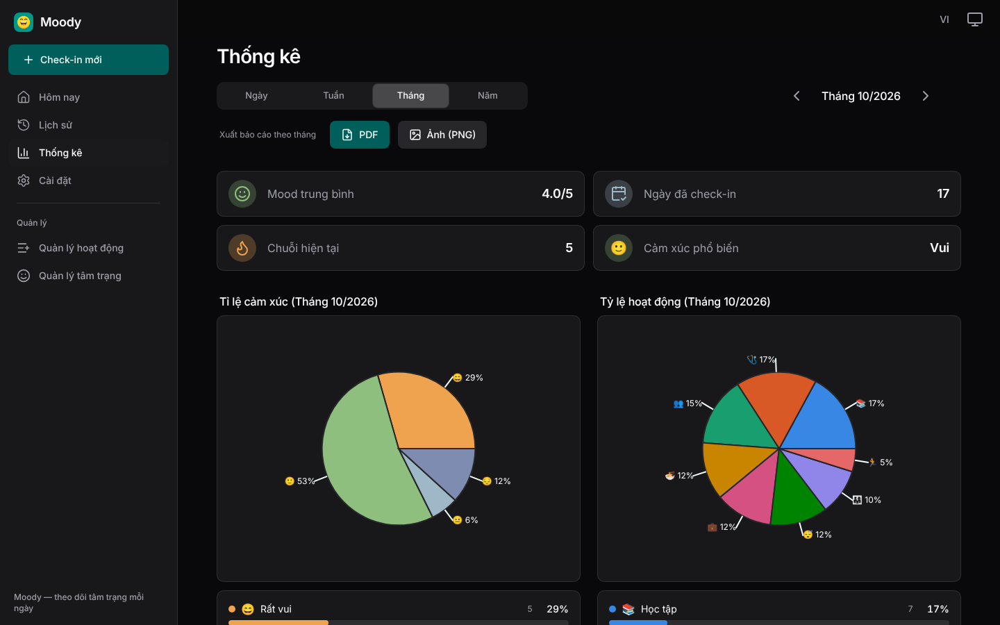

</div>

---

## Table of contents

- [About](#about)
- [Screenshots](#screenshots)
- [Features](#features)
- [Design system](#design-system)
- [Landing page & navigation](#landing-page--navigation)
- [Theme-aware toasts](#theme-aware-toasts)
- [PWA & splash screen](#pwa--splash-screen)
- [Getting started](#getting-started)
- [Tech stack](#tech-stack)
- [Project structure](#project-structure)
- [Scripts](#scripts)
- [Deployment](#deployment)
- [Browser support](#browser-support)
- [Contributing](#contributing)
- [License](#license)

## About

Moody lets you log your mood in seconds: pick one of 5 mood levels, tag the activities of your day and add a note. Review it later as a list, a monthly calendar or statistics charts, or export it as a PDF/PNG report.

- **No account needed** — guest mode keeps data in `localStorage`; sign in with Google to sync through Firestore.
- **Mobile-first, desktop-ready** — bottom navigation on phones, a permanent sidebar and multi-column layouts on laptops.
- **Private by design** — your data is yours: export/import CSV, Excel or JSON at any time.

## Screenshots

| Desktop — History (light) | Desktop — Settings (dark) |
|---|---|
| 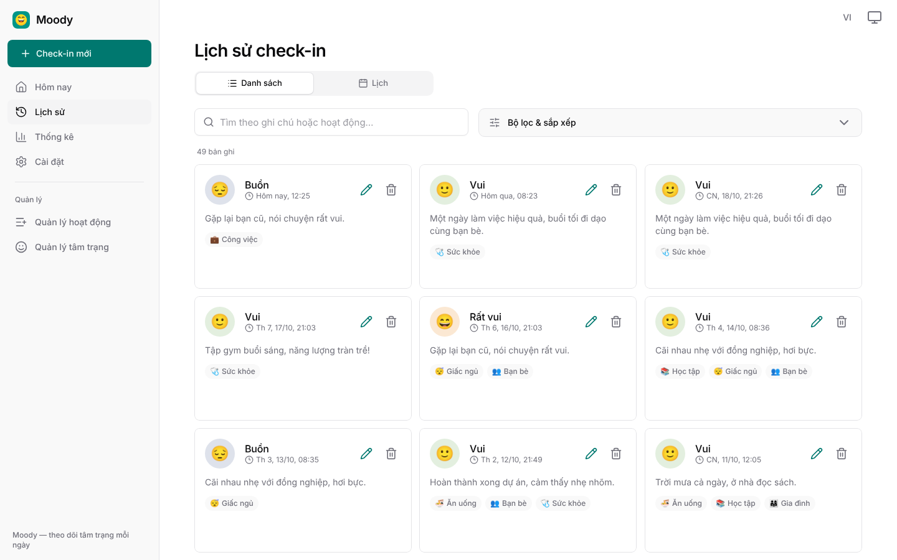 | 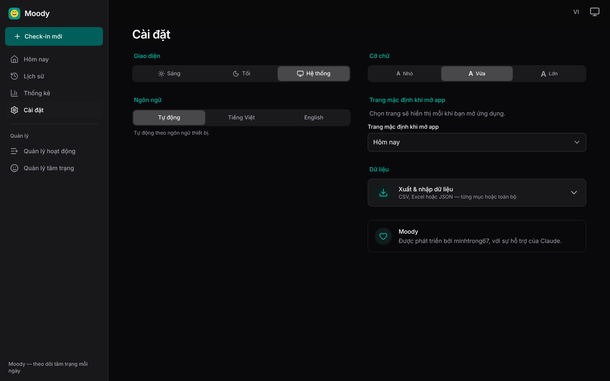 |

| Mobile — Sign in | Mobile — Today | Mobile — Check-in | Mobile — Statistics (dark) | Mobile — History (dark) |
|---|---|---|---|---|
| 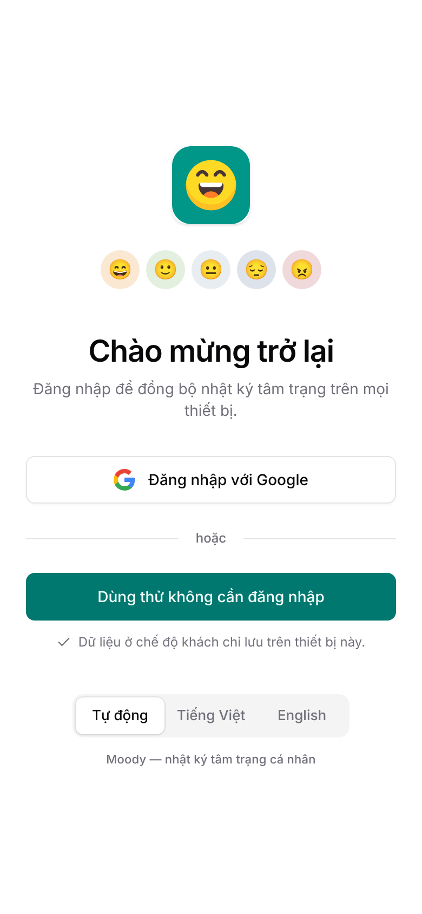 | 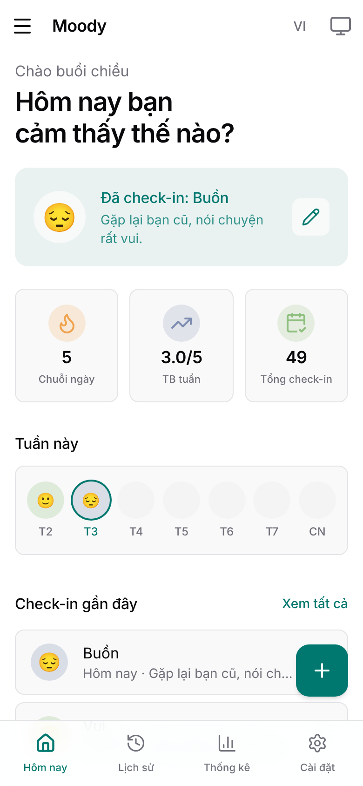 | 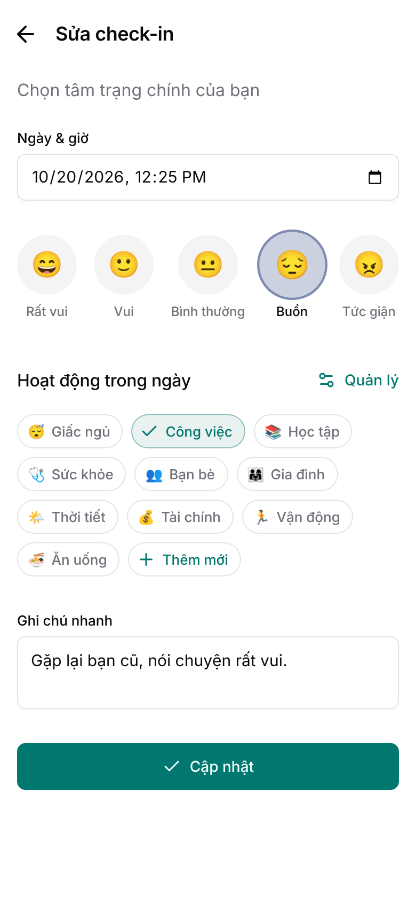 | 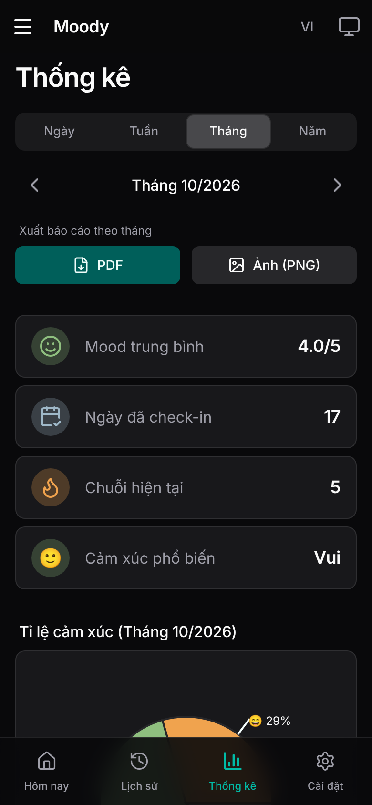 | 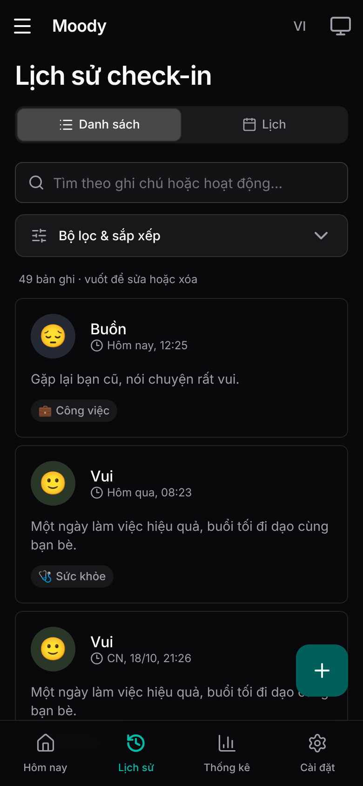 |

## Features

| Area | Description |
|---|---|
| **Today** | Greeting, check-in status, 7-day strip, current streak, weekly average and recent check-ins |
| **Check-in** | Date & time, 1 of 5 moods, multiple activities and an auto-growing note; editable any time |
| **History** | List view (search, filters, sorting, swipe to edit/delete) and monthly calendar view |
| **Statistics** | By day / week / month / year: trend, mood distribution, most frequent activities |
| **Reports** | Export PDF or PNG with key metrics and pie charts |
| **Manage** | Custom activities (drag to reorder) and custom emoji / names for the 5 moods |
| **Landing page** | Responsive marketing page with scroll animations, light/dark/system theme, English/Vietnamese and full SEO / social-share meta |
| **Settings** | Light / dark / system theme, font size, language, start page, PWA install, data export / import |

## Design system

Moody follows a **modern minimalist** style: flat surfaces, hairline borders instead of heavy shadows, generous whitespace, one teal accent, Inter typography and thin-stroke icons ([Lucide](https://lucide.dev)).

**Single source of truth: [`src/styles/theme.css`](src/styles/theme.css)** (teal-zinc, `oklch` tokens, light + `.dark`). Nothing else declares colors.

```
theme.css  ──►  index.css (--c-* roles)  ──►  tailwind.config.js  ──►  bg-surface · text-on-surface · bg-primary/10 …
(oklch tokens)   derived with color-mix()       maps roles to classes
```

- To re-theme the whole app, replace `theme.css` — no other file needs editing.
- `--c-brand` is the accent used for text/icons: it is `--primary` in light mode and a brighter teal (`--chart-2`) in dark mode so it stays readable on dark backgrounds. Filled buttons use `--primary` as defined by the theme.
- Radius derives from `--radius`; chart colors reading from CSS are resolved to hex via canvas (`readRole()` in `src/lib/theme.js`).

## Landing page & navigation

| State | Behaviour |
|---|---|
| First visit / signed out | Opens the landing page (`/#/welcome`). **Log in** → `/#/login`; **Get started** → guest mode. |
| Signed in or guest | Goes straight to the app on every later visit; the landing page is skipped. |
| Settings → Introduction | Opens the landing page again on demand. |
| Log out | Returns to the landing page. |

The share tags (Open Graph, Twitter Card, JSON-LD, canonical, hreflang, `robots.txt`, `sitemap.xml`) point at the production URL **https://moody-mood-tracker.vercel.app/**.

## Theme-aware toasts

Toasts follow the theme (popover surface + hairline border, `success` / `info` / `error` variants) in both light and dark mode.

## PWA & splash screen

The launch splash matches the active theme on both platforms:

| Platform | How it works |
|---|---|
| **Android / Chrome** | The OS draws the splash from the manifest `background_color`, which only accepts **one** color. Moody ships two manifests — `public/manifest.webmanifest` (white) and `public/manifest-dark.webmanifest` (`#09090b`) — and swaps `<link rel="manifest">` and `<meta name="theme-color">` to match the theme (inline script in `index.html` before first paint, then `syncPwaChrome()` in `src/lib/theme.js`). Chrome re-reads the manifest when it updates the installed app, so the splash follows the theme shortly after it changes. |
| **iOS / Safari** | `apple-touch-startup-image` links with `prefers-color-scheme` media queries (38 images: 19 devices × light/dark, portrait) are injected at build time by `vite.config.js`. iOS follows the **system** appearance. |
| **In-app boot screen** | A static, theme-aware loader in `index.html` shows instantly and hands off to React with no flash. |

Limitations: Android only picks up a change after Chrome refreshes the installed app; on iOS the splash follows the system (not the in-app) theme; landscape splash images are not generated.

Regenerate the iOS images after changing the icon or colors: `npm run generate:splash` (colors/devices live in `scripts/splash-devices.mjs`).

## Getting started

Requirements: **Node.js ≥ 18** and npm.

```bash
git clone https://github.com/minhtrong67/Moody-MoodTracker.git moody
cd moody
npm install
cp .env.example .env     # then fill in your Firebase config
npm run dev
```

Open `http://localhost:5173`. **It works without Firebase** — the app falls back to guest mode (local data).

### Firebase setup (optional)

1. Create a project in the [Firebase Console](https://console.firebase.google.com).
2. **Authentication → Sign-in method** → enable **Google**.
3. **Firestore Database** → create a database.
4. **Project settings → Your apps** → create a Web app and copy the values into `.env`:

   | Variable | Meaning |
   |---|---|
   | `VITE_FIREBASE_API_KEY` | Web API key |
   | `VITE_FIREBASE_AUTH_DOMAIN` | `your-project.firebaseapp.com` |
   | `VITE_FIREBASE_PROJECT_ID` | Project ID |
   | `VITE_FIREBASE_STORAGE_BUCKET` | `your-project.appspot.com` |
   | `VITE_FIREBASE_MESSAGING_SENDER_ID` | Sender ID |
   | `VITE_FIREBASE_APP_ID` | App ID |
   | `VITE_SITE_URL` | Deployed URL, no trailing `/` (canonical / Open Graph) |

5. Restrict Firestore so each user can only access their own data:

   ```
   rules_version = '2';
   service cloud.firestore {
     match /databases/{database}/documents {
       match /users/{userId}/{document=**} {
         allow read, write: if request.auth != null && request.auth.uid == userId;
       }
     }
   }
   ```

> ⚠️ `.env` is git-ignored. **Never commit real keys or secrets** to a public repository.

## Tech stack

| Area | Technology |
|---|---|
| UI | React 18, React Router 6 (`HashRouter`) |
| Build / PWA | Vite 5, `vite-plugin-pwa` (Workbox), `sharp` (splash images) |
| Styling | Tailwind CSS 3 + `oklch` theme tokens |
| Typography & icons | Inter Variable (`@fontsource-variable/inter`, Vietnamese included), `lucide-react` |
| Backend | Firebase Authentication (Google) + Cloud Firestore |
| Charts | Recharts |
| Reports | `html2canvas-pro` + jsPDF (loaded on demand) |
| Import / export | `read-excel-file`, `write-excel-file`, `fflate` |
| i18n | Lightweight custom translator (`src/i18n`) |

## Project structure

```
├── index.html                  # SEO / Open Graph meta, theme bootstrap script, boot screen
├── vite.config.js              # Vite + PWA + iOS splash links + chunk splitting
├── tailwind.config.js          # Maps --c-* roles to Tailwind classes
├── public/
│   ├── manifest.webmanifest        # light manifest
│   ├── manifest-dark.webmanifest   # dark manifest (splash color)
│   ├── sitemap.xml · robots.txt
│   ├── landing/                    # landing page screenshots (webp, light/dark)
│   ├── splash/                     # iOS splash images (generated)
│   └── icons/ · favicon · og-image.png
├── scripts/                    # generate-splash.mjs · splash-devices.mjs
├── screenshots/                # images used in this README
└── src/
    ├── styles/theme.css        # ★ color tokens (single source of truth)
    ├── index.css               # derived roles, typography, buttons, fields, motion
    ├── pages/Landing.jsx · Login.jsx   # marketing page · sign-in
    ├── lib/                    # session · theme · moodConfig · dateUtils · statsUtils · reportGenerator · dataTransfer
    ├── components/             # AppShell · Sidebar · Dialog · TextField · Switch · Login …
    ├── pages/                  # Dashboard · CheckIn · History · Statistics · Settings · Manage*
    ├── context/ · hooks/       # Auth, MoodEntries, Activities, Moods, Toast
    └── i18n/                   # vi.js · en.js
```

**Data model** — `users/{uid}/entries/{id}`: `date` (`YYYY-MM-DD`), `time` (ISO), `mood` (`great|good|okay|sad|angry`), `score` (1–5), `activities[]`, `note`. Custom activities / moods live in `users/{uid}/meta/*`; guest mode uses `localStorage`.

## Scripts

| Command | Description |
|---|---|
| `npm run dev` | Dev server with HMR |
| `npm run build` | Production build into `dist/` |
| `npm run preview` | Preview the production build |
| `npm run generate:splash` | Regenerate iOS splash images |

Adding text: add the key to **both** `src/i18n/en.js` and `src/i18n/vi.js`, then use `const {{ t }} = useI18n()`.

## Deployment

Deploy `dist/` to any static host (Vercel, Netlify, Cloudflare Pages, Firebase Hosting). `HashRouter` means no SPA rewrites are required. Set `VITE_SITE_URL` before building, and add your domain to Firebase **Authentication → Settings → Authorized domains** for Google sign-in.

## Browser support

Modern evergreen browsers. The theme relies on `oklch()` and `color-mix()`: Chrome / Edge 111+, Safari 16.4+, Firefox 113+.

## Contributing

1. Fork the repo and create a branch: `git checkout -b feat/your-feature`.
2. Keep to the design system: use theme tokens (`bg-surface`, `text-on-surface-variant`, `text-brand`…), never hard-coded colors.
3. Make sure `npm run build` passes and add UI text to both languages.
4. Open a pull request describing what changed and why.

## License

Released under the [MIT License](LICENSE) © 2026 minhtrong67.
